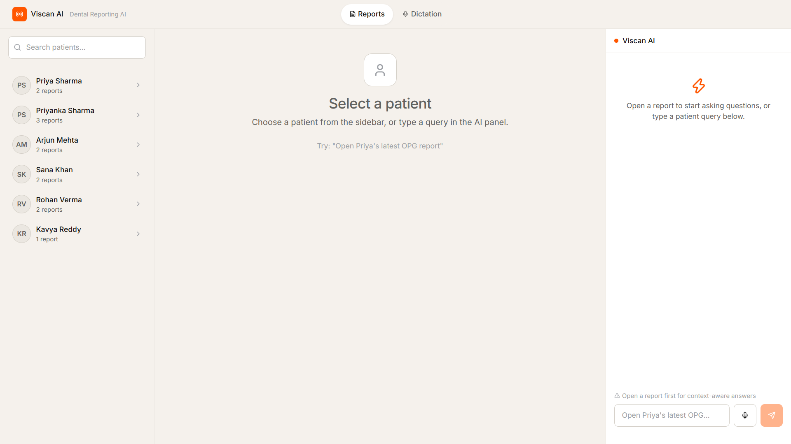
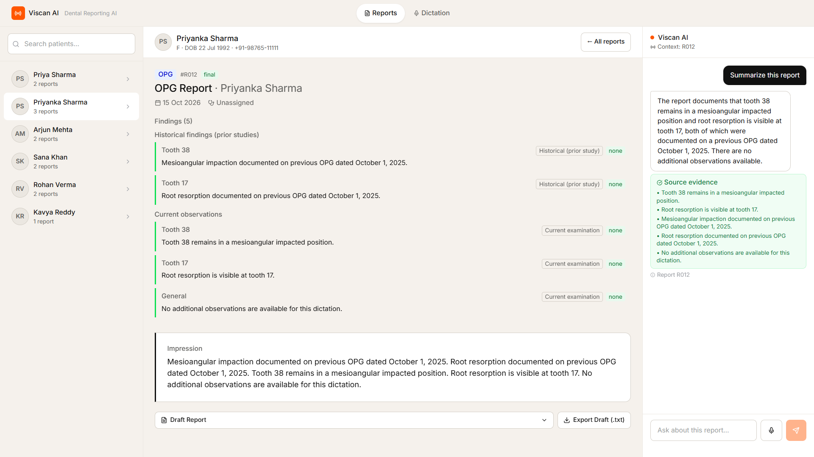

# Viscan AI — AI-Engineered Dental Reporting Assistant





Viscan AI is an **AI-engineered dental reporting assistant**: Google Gemini interprets the clinician's free text (intent recognition + entity extraction), structures clinical dictation into validated report drafts, and answers report-aware questions with quoted evidence. It covers the three mandated workflows — **patient report retrieval**, **clinical dictation → draft report**, and **context-dependent conversational follow-up** — plus a bonus **report-aware chatbot**. Voice input is built in, and a deterministic offline path keeps every workflow runnable with zero API keys.

**Stack:** React 19 + Vite + Tailwind CSS v4 (frontend) · Python + FastAPI + Pydantic (backend) · **Google Gemini** as the primary LLM engine · OpenAI as a secondary provider · deterministic verification guardrails plus an offline path so the app still runs with zero keys.

> Architecture: see [ARCHITECTURE.md](./ARCHITECTURE.md) · Design tokens: [DESIGN.md](./DESIGN.md)

---

## 1. Delivered features (requirement → status)

### A. Patient report retrieval — ✅ delivered (mandatory)

- Typed **or spoken** request such as _"Open Priya's latest OPG report"_ → intent + patient name extracted by the configured LLM (deterministic parser when offline), then deterministic record lookup returns the correct report.
- **Ambiguity is never guessed**: _"Sharma"_ matches Priya Sharma and Priyanka Sharma → the UI shows a disambiguation card; fuzzy candidates within a 0.20 score gap also ask instead of picking.
- **Missing data fails safely**: unknown patients and missing reports return a helpful message, never a fabricated record.

### B. Clinical dictation to draft report — ✅ delivered (mandatory)

- Audio (speech-to-text) **or** a pasted transcript such as _"Lower right third molar is horizontally impacted"_ → **editable structured JSON**: findings, anatomical site, severity, and a readable draft report, structured by Gemini and validated against a Pydantic schema.
- **No invented observations**: every finding is re-verified in Python against the transcript (token-overlap grounding; unsupported findings are dropped and flagged), uncertainties are listed, and `requires_review` is forced to `true`.
- Non-clinical/noise transcripts return `usable: false` → no draft and no Save action.
- The clinician edits the draft, explicitly confirms it, and saves it (existing or new patient) back into the JSON store.

### C. Conversational follow-up — ✅ delivered (mandatory)

- One context-dependent follow-up such as _"Summarise her report"_ is answered by the configured LLM from the **currently open report** — the patient is not asked for again when the reference is unambiguous.
- **Every answer shows its source**: the exact report evidence (finding text) used for the reply is displayed alongside it.
- No open report → guided reply instead of an invented answer.

### Bonus — Report-aware chatbot — ✅ delivered

- Grounded question answering over the selected report (`POST /follow-up`), plus greeting/identity/capability/small-talk routing (`POST /query`). AI-provider and deterministic (no-key) responses are always labelled in the UI (the API field is `demo_mode`).

### Also delivered

- **Google Gemini powers the NLU** — intent classification, patient-name extraction, report-type detection, dictation → structured findings and grounded follow-up answers are all produced by the Gemini API, validated against Pydantic schemas and then re-verified by a deterministic grounding layer before they reach the UI.
- **Voice input** for retrieval and dictation (mic → transcript auto-submits on speech end), with typed-input fallback everywhere.
- **210 automated tests** (183 backend + 27 frontend): **208 run fully offline** and never make a paid API call, plus **2 live Gemini API-call tests** that call the real Gemini API when a key is configured (skipped otherwise). See [§6 Running tests](#6-running-tests-brief).

---

## 2. Setup

**Prerequisites:** Python 3.10+, Node 18+.

### Backend — `http://localhost:8000`

```powershell
cd backend
python -m venv .venv                                     # first run only
.\.venv\Scripts\pip.exe install -r requirements.txt      # first run only
copy .env.example .env                                   # first run only; keys optional
.\.venv\Scripts\python.exe -m uvicorn main:app --reload --port 8000
```

Same thing with an activated virtualenv:

```powershell
cd backend
.\.venv\Scripts\activate
uvicorn main:app --reload --port 8000
```

Sanity check: `http://localhost:8000/health` → `{"status":"ok","demo_mode":true,"llm_provider":null}` — `llm_provider: null` means no provider is configured, so the deterministic offline path is serving requests (set `GEMINI_API_KEY` and this flips to `"llm_provider":"gemini"`, `"demo_mode":false`).

### Frontend — `http://localhost:5173`

```powershell
cd frontend
npm install        # first run only
npm run            # list the available scripts
npm run dev        # → http://localhost:5173
```

Open **http://localhost:5173** in your browser.

### Ports

| Service             | URL                     | Where it is defined                                                                               |
| ------------------- | ----------------------- | ------------------------------------------------------------------------------------------------- |
| Backend API         | `http://localhost:8000` | `--port 8000` above; `frontend/src/api.js` → `VITE_API_URL \|\| 'http://localhost:8000'`          |
| Frontend dev server | `http://localhost:5173` | Vite default port (no override in `vite.config.js`); allowed by backend CORS in `backend/main.py` |

To use another API port, set `VITE_API_URL` in `frontend/.env` **and** add that origin to the CORS list in `backend/main.py`.

---

## 3. API instructions

Base URL: `http://localhost:8000` · Interactive docs: `http://localhost:8000/docs`

| Method | Path                     | Purpose                                                |
| ------ | ------------------------ | ------------------------------------------------------ |
| GET    | `/health`                | Health + `demo_mode` (true = no provider configured) + active `llm_provider` |
| GET    | `/patients`              | List patients                                          |
| GET    | `/patients/{id}/reports` | Reports for a patient                                  |
| GET    | `/reports/{id}`          | Full report detail                                     |
| POST   | `/query`                 | NLU: intent + patient-name resolution + retrieval      |
| POST   | `/dictation`             | Transcript → structured findings + editable draft      |
| POST   | `/follow-up`             | Grounded question answering on one report              |
| POST   | `/reports`               | Save an edited draft (creates a new patient if needed) |

### Examples

> On Windows PowerShell, call `curl.exe` (plain `curl` there is an alias for `Invoke-WebRequest`).

```bash
# A. Patient report retrieval
curl -X POST http://localhost:8000/query \
  -H 'Content-Type: application/json' \
  -d '{"text": "Open Priya latest OPG report"}'

# B. Clinical dictation → structured draft
curl -X POST http://localhost:8000/dictation \
  -H 'Content-Type: application/json' \
  -d '{"transcript": "Lower right third molar is horizontally impacted"}'

# C. Conversational follow-up (report_id from a previous /query or /reports call)
curl -X POST http://localhost:8000/follow-up \
  -H 'Content-Type: application/json' \
  -d '{"question": "Summarise the findings", "report_id": "R001"}'
```

### Sample response — retrieval

```json
{
  "intent": "retrieve_report",
  "patient_name": "Priya Sharma",
  "report_type": "OPG",
  "matched_patients": [{ "id": "P001", "name": "Priya Sharma" }],
  "report": {
    "id": "R001",
    "type": "OPG",
    "date": "2025-11-10",
    "status": "final",
    "findings": [
      {
        "site": "Upper left quadrant",
        "observation": "Periapical radiolucency at 26 (upper left first molar)",
        "severity": "moderate"
      }
    ],
    "impression": "Periapical pathology at 26 requiring endodontic evaluation. …"
  },
  "ambiguous": false,
  "demo_mode": true,
  "message": "Showing the latest OPG report for Priya Sharma dated 2025-11-10."
}
```

An ambiguous request returns `"ambiguous": true`, the candidate list in `matched_patients`, `"report": null`, and a message asking the user to choose. `"demo_mode": true` means no provider was configured and the deterministic offline path served the response; responses from a configured provider may additionally carry `fallback_reason` / `limitation` explaining a provider failure or a deliberate capability limit.

---

## 4. Model & provider choices

**The AI pipeline is the architecture: LLM interpretation → Pydantic schema validation → deterministic retrieval & business rules → grounded response.** Gemini (`gemini-3.5-flash-lite` by default, configurable via `GEMINI_MODEL`) is the primary engine behind every NLU stage — intent classification, patient-name/entity extraction, report-type detection, clinical-dictation structuring, and grounded follow-up answers. Each request is a single-turn, JSON-structured prompt (`temperature 0.1`, `maxOutputTokens 1024`) validated against Pydantic schemas; only then do deterministic tools touch the records, and the response is re-checked against its source text before it reaches the UI.

Regex and heuristics are **not** the NLU — they are the deterministic guardrail layer that sits alongside the model, plus an offline path:

- **Guardrails (always on, even with a live key):** rules re-verify what the model produced — e.g. every returned finding must be supported by the transcript (token-overlap grounding), and prompts-injection / refusal-style text is filtered before it reaches the model. The model proposes; the rules veto. This is the standard "LLM + verifier" pattern for clinical-grade output, not a substitute for the model.
- **Data-access boundary:** the LLM never reads or writes `backend/data/*.json`. Record lookup and safe writes run in pure Python (`backend/services/retrieval.py`). The only report content that leaves the backend is prompt text the backend builds itself — for grounded follow-up answers, the selected report's relevant content (ids, findings, impression) — and the answer's evidence is re-verified against the stored report before it reaches the UI.
- **Offline / deterministic mode (no provider configured):** the same pipeline stages are served by deterministic parsers so the app remains fully usable and testable with zero keys. This is a resilience and testing mechanism — it lets reviewers and CI run without credentials — and it never claims AI: with no `GEMINI_API_KEY`/`OPENAI_API_KEY` no model call is made, responses carry `demo_mode: true`, and the UI labels them as deterministic. It is the fallback, not the design.

| Stage                    | Choice                                                                                                                                              | Why                                                                                                              |
| ------------------------ | --------------------------------------------------------------------------------------------------------------------------------------------------- | ---------------------------------------------------------------------------------------------------------------- |
| **Voice / STT**          | Browser Web Speech API in the frontend (`frontend/src/useSpeechRecognition.js`, `en-IN`), mic transcript auto-submits; typed input always available | No audio files uploaded, no server-side STT key or cost; transcript enters the exact same pipeline as typed text |
| **LLM — primary**        | **Google Gemini**, default `gemini-3.5-flash-lite` via `GEMINI_API_KEY` (`GEMINI_MODEL` to override)                                                | Flash tier: cheapest/lowest-latency option for short JSON-structured clinical prompts                            |
| **LLM — fallback**       | **OpenAI `gpt-4o-mini`** via `OPENAI_API_KEY`, used only when the Gemini key is blank                                                               | Second provider for regions/accounts without Gemini access                                                       |
| **Guardrails + offline** | Deterministic verification rules and, with no provider configured, offline parsers in `backend/services/llm_service.py`                                             | Grounding/enforcement is auditable and instant; app stays fully usable, testable and free with zero keys         |
| **Tools / data access**  | Pure Python functions in `backend/services/retrieval.py` over `backend/data/*.json` — **the LLM has no access to these files** | Record lookup must be exact, auditable and instant; only prompt text is ever sent to a provider                   |
| **Output validation**    | Pydantic schemas in `backend/models.py` on every model response                                                                                     | Malformed or invented model output never reaches the UI                                                          |

Provider errors (404 model unavailable, 429/503 capacity, malformed JSON) are retried briefly and then answered deterministically, with the reason surfaced as `fallback_reason` — never a 500.

---

## 5. Environment variables (sample)

Copy `backend/.env.example` → `backend/.env`:

```dotenv
# Google Gemini (primary). Leave blank → deterministic offline path (no AI
# calls), or the OpenAI fallback below.
GEMINI_API_KEY=
GEMINI_MODEL=gemini-3.5-flash-lite

# OpenAI (optional legacy fallback; used only when GEMINI_API_KEY is blank)
OPENAI_API_KEY=
```

Optional `frontend/.env`:

```dotenv
VITE_API_URL=http://localhost:8000
```

**Secrets handling:** no API key exists anywhere in the committed code — only the empty `.env.example` template is tracked. `.env` (backend and frontend) is listed in `.gitignore` and is not, and has never been, committed; verify any time with:

```powershell
git check-ignore backend/.env     # → matches .gitignore
git ls-files backend/.env         # → empty (nothing to push)
```

---

## 6. Running tests (brief)

```powershell
cd backend
.\.venv\Scripts\python.exe -m pytest tests/ -q     # 183 passed (~20 s: 181 offline ~5 s + 2 live ~15 s)

cd ..\frontend
npm test                                           # 27 passed (~5 s)
```

**Totals: 210 automated tests — 183 backend (181 offline + 2 live) + 27 frontend — of which 208 never make a paid API call and 2 are real Gemini API-call tests.**

- **Keys are blanked for the whole session** (`tests/conftest.py` runs before any test module), so the **181 offline backend tests can never make a paid API call** - not even if pytest imports the modules in a different order.
- **2 live Gemini API-call tests** - `tests/test_live_api.py`, marked `live` - are the deliberate exception, and the only tests in the suite allowed to call a provider. They re-install the Gemini key from `backend/.env`, force the app out of offline mode (`demo_mode: false`), and make one real API request each to prove the live path end to end:
  - `POST /query` is answered by Gemini (correct intent, patient `P001`, no fallback),
  - `POST /dictation` structures real model output with every finding still passing the deterministic grounding and severity checks and `requires_review` forced.
  Each asserts the request actually went out **and** succeeded (`fallback_reason` empty), so a failed call fails the test instead of hiding behind the deterministic fallback. They **skip** - never fail - when no key is configured.
- Skip the live pair anywhere (CI without secrets) with `-m "not live"`, or set `VISCAN_LIVE_TESTS=0`. Cost: two short Gemini free-tier requests per run.
- Backend covers retrieval + name resolution + ambiguity, missing records, no fabricated findings, unusable transcripts, `requires_review` always true, empty-input 422s, provider-failure fallbacks, follow-up context, and save/confirm/new-patient flows.
- Frontend (Vitest + Testing Library) covers the ambiguity panel, unusable-dictation state and the new-patient entry dialog.

---

## 7. Privacy, cost & authorization

### Privacy

- All patient data is **entirely synthetic** (6 patients, 12 reports) — no real records, no PII.
- Everything stays local: reads and writes (saving an edited draft, creating a patient) append to `backend/data/*.json` on your machine. Nothing is uploaded anywhere except the prompt text the backend sends to the configured LLM provider when a key is set — for report questions that is the selected report's relevant content (ids, findings, impression), never the store itself: the LLM has no access to `backend/data/*.json`, and all record I/O stays in the backend.
- `backend/.env` with your key is git-ignored and never pushed. Restore pristine fixtures with `git checkout backend/data`.

### Cost & latency

**This project runs on Google's free Gemini API tier — actual running cost is `₹0 / $0`.** Gemini's free tier provides a generous per-minute and per-day request quota, which is far more than this app's traffic (single user, ~1–2 short LLM calls per request). No billing account is required to run it. See [ai.google.dev/pricing](https://ai.google.dev/gemini-api/docs/pricing) for the current free-tier limits.

- **Offline mode (no provider configured):** zero cost, sub-millisecond responses, every feature still works — served deterministically, labelled as such, and never presented as AI output.
- **Live mode (Gemini free tier):** zero cost; observed 2–6 s healthy, 5–18 s during provider-side pressure (bounded retries add ~3 s) before the deterministic guardrail answers.

#### What the same app would cost on other providers

Gemini's free tier is the reason this build has no bill. If you re-point the same pipeline at a paid-only provider, cost is driven by the prompt sizes below:

| Token profile per request                      | Input tokens | Output tokens |
| ---------------------------------------------- | ------------ | ------------- |
| Retrieval / follow-up (`/query`, `/follow-up`) | ~500–900     | ~150–300      |
| Dictation → structured draft (`/dictation`)    | ~700–1,200   | ~250–500      |

Each call is single-turn (no conversation history is replayed), `temperature 0.1`, capped at 1,024 output tokens. A typical full three-workflow session (~30 LLM calls) ≈ **25K input + 10K output tokens**.

Approximate list prices for that session volume (USD per 1M tokens, provider list price — verify against the provider's current pricing page before relying on it):

| Provider                      | Model (small / fast tier)  | Input $/1M | Output $/1M | Est. cost / 30-call session     |
| ----------------------------- | -------------------------- | ---------- | ----------- | ------------------------------- |
| **Google Gemini (free tier)** | `gemini-3.5-flash-lite`    | **$0**     | **$0**      | **$0 — what this project uses** |
| Google Gemini (paid tier)     | `gemini-3.5-flash-lite`    | ~$0.10     | ~$0.40      | < $0.01                         |
| OpenAI                        | `gpt-4o-mini`              | ~$0.15     | ~$0.60      | ~$0.01                          |
| OpenAI                        | `gpt-4o`                   | ~$2.50     | ~$10.00     | ~$0.18                          |
| Anthropic                     | `claude-haiku` (small)     | ~$1.00     | ~$5.00      | ~$0.08                          |
| Anthropic                     | `claude-sonnet` (flagship) | ~$3.00     | ~$15.00     | ~$0.23                          |
| Mistral AI                    | `mistral-small`            | ~$0.20     | ~$0.60      | ~$0.01                          |
| Groq (hosted Llama)           | `llama-3.1-8b-instant`     | ~$0.05     | ~$0.08      | < $0.01                         |

At this scale every option is cheap in absolute terms — the point of the Gemini free tier is that a portfolio/hackathon build like this one can demo **unlimited live-LLM runs with no credit card at all**, while the architecture stays a one-line `GEMINI_MODEL` / `OPENAI_API_KEY` swap to move to any paid provider.

---

## 8. Known limitations

1. **Offline (no-provider) path is rule-based and is the fallback, not the product** — with no Gemini/OpenAI key configured, intent detection and parsing are served by deterministic rules, which miss complex phrasings; those responses carry `demo_mode: true` and are never presented as AI. **Configure `GEMINI_API_KEY` and Gemini handles these through natural-language understanding**; the offline path exists as a resilience and testing mechanism so the app runs with zero credentials.
2. **Fuzzy name matching** — token/prefix similarity with a 0.45 threshold; exact full names always resolve, partial names matching 2+ patients within a 0.20 score gap require clarification. Very short or misspelled names may still be missed or over-matched.
3. **Follow-up context = the open report** — pronouns such as "her report" are not resolved across patients.
4. **Voice input is browser-native** — the Web Speech API works best in Chrome/Edge (which may send audio to the speech provider, so a network connection is needed); Firefox/older Safari fall back to typed input. Mic flows are not covered by automated tests.
5. **Model availability varies by account** — `GEMINI_MODEL` can return 404/503; the backend retries, then falls back deterministically (`fallback_reason` in the response). Override `GEMINI_MODEL` in `backend/.env`.
6. **Draft prose is not fully grounding-checked** — findings are re-verified against the transcript (token-overlap check); the surrounding free text is model-written, hence the always-on review gate.
7. **No report images** — the viewer shows structured text, not DICOM.
8. **No persistent sessions** — conversation context lives in React state; a refresh clears it.
9. **Single-user** — no multi-tenancy or concurrent session handling.
10. **Not for clinical use** — an architecture demonstration, not a certified clinical product.

---

## 9. Repository layout

```
VISCAN AI/
├── backend/
│   ├── main.py                 # FastAPI app + all endpoints + CORS
│   ├── models.py               # Pydantic request/response schemas
│   ├── services/
│   │   ├── retrieval.py        # deterministic data lookup (no LLM) + safe writes
│   │   └── llm_service.py      # Gemini/OpenAI calls, prompts, offline fallbacks, grounding checks
│   ├── data/                   # synthetic patients.json / reports.json
│   ├── tests/                  # 183 pytest tests (181 offline + 2 live LLM API calls)
│   ├── .env.example            # environment template (real .env is git-ignored)
│   └── requirements.txt
├── frontend/
│   └── src/
│       ├── App.jsx             # 3-panel application
│       ├── api.js              # fetch client → http://localhost:8000
│       ├── useSpeechRecognition.js  # Web Speech API voice input
│       └── __tests__/          # 27 vitest tests
├── ARCHITECTURE.md             # one-page architecture (LLM interpretation → schema validation → deterministic tools → grounded response)
├── DESIGN.md                   # design tokens
└── README.md
```
